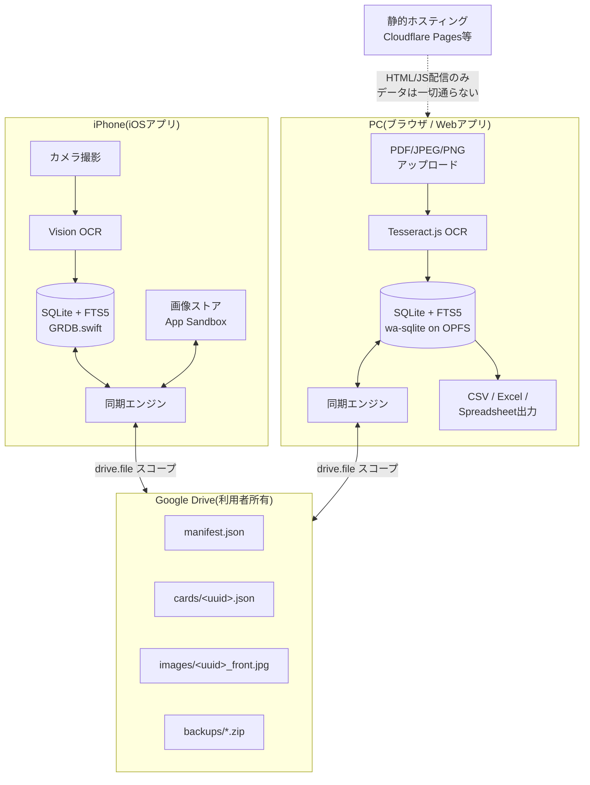
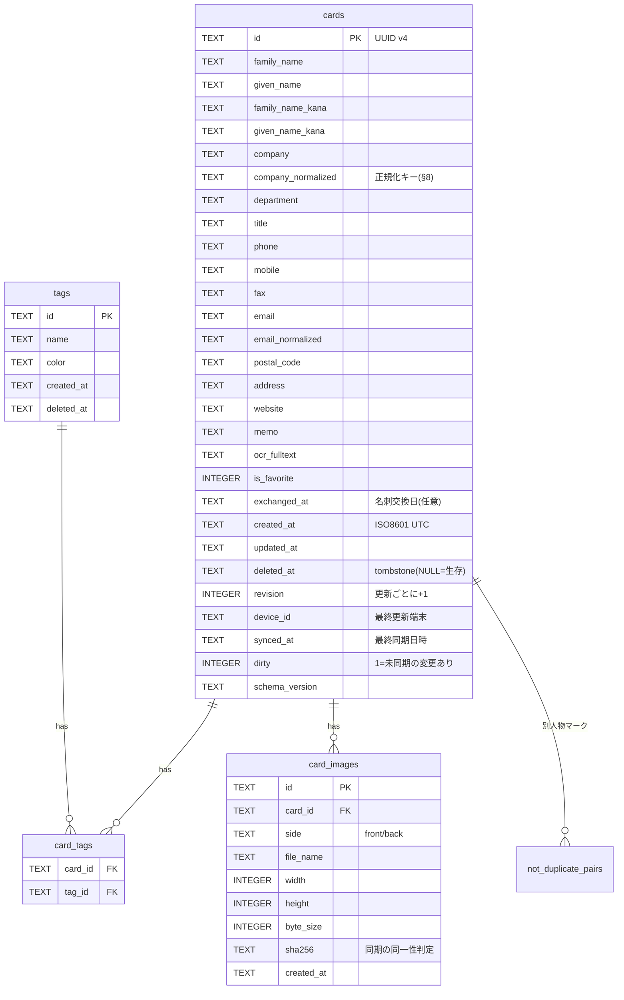
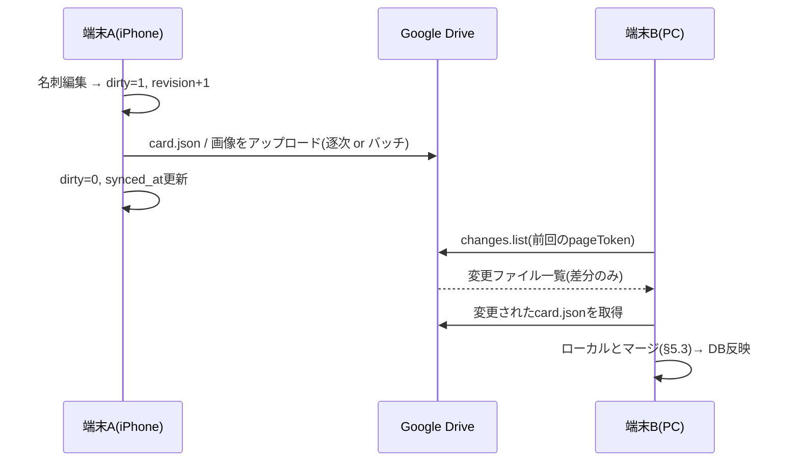
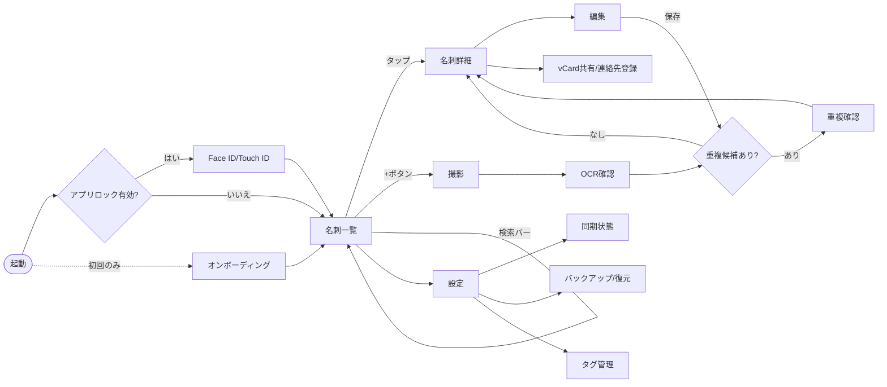
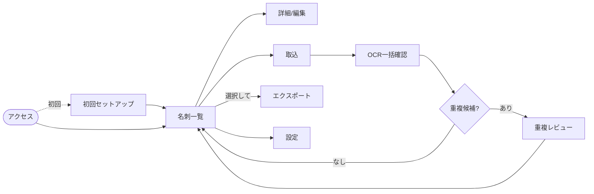

# 名刺管理プラットフォーム 設計書

**仮称: MeishiVault(メイシーボールト)**

| 項目 | 内容 |
|---|---|
| 作成日 | 2026-07-19 |
| ステータス | ドラフト v1.0(コード実装前の設計フェーズ) |
| 対象 | iOSアプリ(SwiftUI)+ Webアプリ(ブラウザ) |
| コンセプト | Privacy First / Offline First / User Owns Their Data / Fast / Simple |

---

## 0. 最初に:要件への変更提案(重要)

ご提示の要件は全体として一貫性が高く、実現可能です。ただし、以下の7点は**元の案のまま進めると後で行き詰まる**ため、設計変更を提案します。各提案の詳細は該当章で説明します。

| # | 元の案 | 提案 | 理由(要約) | 詳細 |
|---|---|---|---|---|
| 1 | Web: React または Next.js | **Vite + React SPA(Next.js不採用)** | サーバを持たない本製品にNext.jsのSSR/APIルートは不要。静的配信+PWAが最適 | §3 |
| 2 | DB候補: SQLite/SwiftData/CoreData/Realm | **SQLite(iOS: GRDB.swift / Web: wa-sqlite)で統一** | FTS5全文検索・同期制御・iOS/Web共通スキーマのすべてを満たすのはSQLiteのみ | §3, §4 |
| 3 | 同期: ローカルDB→Drive | **DBファイル丸ごとではなく「1名刺=1JSON+画像」で同期** | DBファイル同期は競合時に全損リスク。レコード単位なら競合が名刺単位に局所化 | §5 |
| 4 | Google Drive API | **OAuthスコープは `drive.file` に限定** | フルアクセススコープはGoogleの年次セキュリティ審査(CASA、数十万円規模)が必要。`drive.file` なら不要でプライバシー訴求にも合致 | §6 |
| 5 | 買い切り販売(iOS+Web) | **Web版は無償提供を推奨**(または将来ライセンスキー) | サーバもアカウントも持たない構成では、Web版の購入確認手段が存在しない。ここは要件の矛盾点 | §20 |
| 6 | — | **クラウド抽象化レイヤを最初から設計**(将来iCloud/Dropbox対応可能に) | Drive API仕様変更・審査リスクへの保険。実装はDriveのみでよい | §5 |
| 7 | — | **重複検知はMVPに含める** | 「最重要機能」とのことなので、後付けではなくデータモデルに正規化キーを最初から組み込む | §8, §18 |

> **2026-07-19 合意状況**: #1(Vite + React SPA)・#3(レコード単位同期)・#5(Web版無償)は**ユーザー合意済み**。#4は組織利用に関する再検討により一部改訂(個人同期はdrive.file維持、組織対応は段階化。§6.3改訂版参照)。#2・#6・#7は技術判断として本設計で採用。

---

## 1. エグゼクティブサマリー

### 1.1 プロダクトの本質

本製品は「名刺管理SaaS」ではなく、**「名刺データの所有権を利用者に返すローカルファーストアプリ」**である。競合(Eight、Sansan、Wantedly People等)はすべて名刺データを事業者のサーバに集約するモデルであり、以下の顧客層を取りこぼしている。

- 顧客情報を外部サーバに置けない士業・医療・金融・自治体
- 情報セキュリティポリシー上SaaSを使えない企業
- サブスクリプション疲れのある個人ユーザー

この層に対して「**運営者はあなたの名刺を1枚も見られない**」という構造的な保証(ポリシーではなくアーキテクチャによる保証)を売る。これが本製品の差別化の核である。

### 1.2 アーキテクチャの要点

- **サーバレス(バックエンド不在)**: 運営者が管理するサーバは存在しない。Webアプリは静的ファイル配信のみ。したがって運営者がデータを保持することは物理的に不可能。
- **ローカルファースト**: 全機能(撮影・OCR・検索・編集)は端末内で完結。ネットワークは同期時のみ使用。
- **Google Driveは「利用者の倉庫」**: アプリはDrive上の自アプリ作成ファイルにのみアクセス(`drive.file` スコープ)。組織利用はShared Driveをそのまま使い、権限管理はGoogle Workspaceに委譲。
- **OCRは端末内実行**: iOSはApple Vision Framework、WebはTesseract.js(WASM)。画像が端末外に出るのはユーザー自身のDriveへの同期時のみ。

### 1.3 主要技術スタック(結論)

| レイヤ | iOS | Web |
|---|---|---|
| UI | SwiftUI | React 18 + TypeScript + Vite |
| DB | SQLite(GRDB.swift)+ FTS5 | SQLite(wa-sqlite)+ OPFS + FTS5 |
| OCR | Vision Framework(日英) | Tesseract.js(jpn+eng) |
| 同期 | Google Drive API v3(`drive.file`) | 同左(Google Identity Services) |
| 認証 | ASWebAuthenticationSession + PKCE | GIS Token Model |
| 生体認証 | LocalAuthentication(Face ID/Touch ID) | —(§14参照) |
| 配布 | App Store(買い切り) | 静的ホスティング(PWA) |

### 1.4 MVPの範囲(結論のみ、詳細は§18)

**MVP = iOSアプリ単体で完結する名刺管理**(撮影・OCR・編集・検索・タグ・お気に入り・重複検知・vCard・連絡先登録)+ ローカルバックアップ。Google Drive同期はMVP直後のPhase 2、WebアプリはPhase 3。理由: 同期は最も設計難度が高く、単体で価値検証してから投資すべきため。ただし**データモデルとファイルフォーマットは初日から同期前提で設計する**(後述のcard.jsonスキーマ)。

---

## 2. システム全体構成

### 2.1 全体図



### 2.2 構成上の原則

1. **運営者インフラは静的配信のみ**: Webアプリの配信元(Cloudflare Pages / GitHub Pages等)はJS/CSS/HTMLを配るだけ。テレメトリなし、外部スクリプトなし。これにより「データを預からない」がコードレベルで検証可能になる(ブラウザのNetworkタブで確認できる)。
2. **端末間の直接通信はしない**: iPhone⇔PCのデータ受け渡しは必ずGoogle Drive経由。P2P同期は複雑度が高くMVPに不要。
3. **同期はオプション**: Drive未接続でも全機能が動く。同期はあくまで「バックアップ+マルチデバイス」のための追加機能。
4. **1データフォーマット原則**: iOS/Webは実装言語が違うが、DBスキーマ・card.jsonフォーマット・正規化ルール・重複判定ロジックは単一の仕様書(§10)+共通テストベクタで完全一致させる。

### 2.3 データの流れ(ライフサイクル)

```
撮影/取込 → OCR → フィールド抽出 → 確認・編集画面 → 重複チェック
  → ローカルDB保存(即時、オフラインでも完了)
  → [Drive接続済みなら] バックグラウンドで card.json + 画像をアップロード
  → 他端末が次回同期時に差分取得(Drive Changes API)
```

---

## 3. 技術選定理由

### 3.1 ローカルDB比較(iOS)

| 観点 | SQLite (GRDB.swift) | SwiftData | Core Data | Realm |
|---|---|---|---|---|
| 日本語全文検索(FTS) | ◎ FTS5+トークナイザ制御 | × なし | × なし(自前実装) | △ 限定的 |
| スキーマの完全制御(同期に必須) | ◎ | × 内部形式が不透明 | △ | △ |
| Webと同一スキーマ共有 | ◎ 同じSQLite | × | × | × |
| マイグレーション制御 | ◎ 明示的 | △ 自動だが制御弱い | ○ | ○ |
| 変更追跡(同期用メタデータ) | ◎ 自前で厳密に | △ | △ | ○ |
| 将来性・保守 | ◎ SQLiteは事実上永続、GRDBは活発 | ○ ただしまだ発展途上 | ○ 実質メンテナンスモード | **× MongoDBがDevice Sync廃止・投資縮小** |
| 暗号化 | ◎ iOS Data Protection(+必要ならSQLCipher) | ○ | ○ | ○ |

**結論: GRDB.swift(SQLite)を採用。**

- 決定打は3つ: (1) **FTS5による日本語全文検索**は本製品の「Fast」要件の中核で、SwiftData/Core Dataでは実現できない。(2) 同期エンジンを自作する以上、**変更追跡メタデータ(updated_at、tombstone、dirty flag)をスキーマレベルで厳密に制御**する必要があり、抽象化の厚いORMはむしろ邪魔になる。(3) **Webと同じSQLite方言・同じFTS設定**を使えるため、検索挙動やスキーマの二重管理が消える。
- Realmは機能的には候補だが、MongoDB社がAtlas Device Syncを廃止しRealm SDKへの投資を縮小しており、10年保守する買い切り製品の土台には不適。
- SwiftDataは2026年時点でもFTSなし・クエリ表現力不足・iOSバージョン依存の挙動変化があり、時期尚早。

### 3.2 Web: React SPA(Vite) vs Next.js

| 観点 | Vite + React SPA | Next.js |
|---|---|---|
| サーバ不要(本製品の絶対条件) | ◎ 純粋な静的ファイル | △ static exportは可能だが、SSR/API Routes/ISR等の主要機能をすべて捨てて使うことになる |
| Privacy Firstとの整合 | ◎ 「配信サーバはJSを配るだけ」を構成で証明 | △ フレームワークがサーバ機能を持つこと自体が説明コスト |
| PWA/オフライン | ◎ vite-plugin-pwa で素直 | ○ 可能だが本流でない |
| WASM(SQLite/Tesseract)との相性 | ◎ | ○ |
| 学習・保守コスト | 低 | 中(App Router等の変化が速い) |

**結論: Vite + React + TypeScript のSPA(PWA)。**

Next.jsの価値はサーバサイド機能とSEOにあるが、本製品は (1) サーバを持たないことが売り、(2) アプリ本体はログイン後相当の画面でSEO不要、のためNext.jsを選ぶ理由が消滅する。むしろ「Next.jsなのにサーバ機能を全部使わない」という不自然な構成は保守者を混乱させる。ランディングページ(製品紹介サイト)だけは別途Astro等で作ればSEOも満たせる。

- **状態管理**: Zustand(小さく、SQLiteが真のstoreなのでUI状態のみ管理)
- **Webのストレージ**: OPFS(Origin Private File System)上にwa-sqliteでSQLite DBを配置。IndexedDBに比べ性能・耐久性・SQLite公式サポートの点で優位。Safari/Chrome/Edge/Firefoxの現行版はすべてOPFS対応済み。
- **Excel出力**: ExcelJS(MIT、npmで保守が活発)をブラウザ内で実行。SheetJSはnpmレジストリへの公開が停止し独自CDN配布のみになっているため不採用。CSVはBOM付きUTF-8(Excel日本語対応)。Google Spreadsheet出力はSheets API(スコープ `drive.file` と同時取得できる `spreadsheets` を追加同意)。

### 3.3 OCR選定

| | 第一候補 | 代替 | 備考 |
|---|---|---|---|
| iOS | **Vision Framework**(`VNRecognizeTextRequest`, ja-JP + en-US) | — 不要 | 日本語認識精度は名刺用途で実用十分。完全オンデバイス・無料・OS標準 |
| Web | **Tesseract.js**(jpn + eng, WASM) | PaddleOCR(ONNX Runtime Web)/ 将来はWebGPUベースモデル | Tesseractの日本語精度はVisionに劣る(§20リスク参照)。前処理で補う |

Webの精度差は既知のリスクとして受け入れ、(1) 二値化・傾き補正などの前処理、(2) 全結果編集可能UI、(3) 「iPhoneで撮った名刺はiPhoneでOCR済み」という運用実態(Web側は主にScanSnap PDF取込)で緩和する。クラウドOCRは要件どおり不採用。

### 3.4 その他の選定

- **画像フォーマット**: 保存はJPEG(品質0.8、長辺2048px)。HEICはWeb互換性がないため同期対象では使わない。原本志向のユーザー向けに「高解像度保存」設定(長辺4096px)を用意。
- **iOS最低バージョン**: iOS 17以上(Vision日本語・SwiftUI安定性・普及率のバランス)。
- **共有仕様の担保**: 正規化・重複判定はSwift/TypeScriptで二重実装になるため、**共通テストベクタ(JSON)**をリポジトリに置き、両実装が同一入出力を返すことをCIで検証する。

---

## 4. データベース設計

### 4.1 ER図



### 4.2 要件のデータ項目への追加提案

要件記載の項目(UUID/姓/名/会社名/部署/役職/電話/携帯/メール/住所/郵便番号/Web/FAX/タグ/メモ/OCR全文/画像/作成・更新・最終同期日時)に加え、以下を追加する。

| 追加項目 | 理由 |
|---|---|
| **姓かな・名かな** | 日本の名刺管理では五十音順ソートが必須。漢字だけではソート不能。OCR後にユーザー入力(将来は自動かな推定) |
| **company_normalized / email_normalized** | 重複検知(§8)の事前計算キー。検索・判定をO(1)にする |
| **名刺交換日・交換場所(任意)** | 「いつどこでもらったか」は名刺の文脈そのもの。将来の交換履歴機能の土台 |
| **is_favorite** | 要件のお気に入り機能のフラグ |
| **revision / device_id / dirty / deleted_at** | 同期エンジン用メタデータ(§5)。削除は物理削除ではなくtombstone |
| **card_images.sha256** | 画像の差分同期判定(バイト比較せずハッシュで) |
| **not_duplicate_pairs(card_id_a, card_id_b)** | 「別人物」と判定したペアを記憶し、同じ候補を再提示しない |

電話番号系は自由書式で保存し、正規化値(数字のみ)は検索・重複判定時に導出する(表示は名刺の記載どおりを尊重)。

### 4.3 全文検索インデックス(FTS5)

```sql
CREATE VIRTUAL TABLE cards_fts USING fts5(
    family_name, given_name, family_name_kana, given_name_kana,
    company, department, title, phone, mobile, email,
    tags_text,        -- タグ名を連結して非正規化
    ocr_fulltext,
    content='cards',  -- external contentモード(本体はcardsテーブル、FTS側はインデックスのみ保持)
    tokenize='trigram'
);
```

- **トークナイザはtrigram**を採用。日本語は分かち書きがないためunicode61では語単位検索が機能しない。trigramなら「山田」「営業部」等の部分一致が形態素解析なしで高速に効く。2文字以下のクエリはLIKEフォールバック(インデックス補助に `company_normalized` 等の通常インデックスを併用)。
- cardsテーブルの挿入/更新/削除トリガでFTSを同期。インクリメンタルサーチは入力200msデバウンス+`snippet()`でハイライト。
- 通常インデックス: `email_normalized`, `phone(正規化)`, `company_normalized`, `updated_at`, `is_favorite`, `deleted_at`。

### 4.4 画像の保存場所

| | 場所 | 理由 |
|---|---|---|
| iOS | App Sandbox内 `Documents/images/`(Data Protection: `completeUntilFirstUserAuthentication`) | DBにBLOBを入れると肥大化しFTS性能に響く。ファイルはiOSレベルで暗号化 |
| Web | OPFS `images/` ディレクトリ | 同上。OPFSはオリジン外から読めない |
| サムネイル | 各端末で生成(長辺400px)、同期しない | 導出データは同期不要。一覧スクロール性能のため |

---

## 5. 同期アーキテクチャ

### 5.1 基本方針: レコード単位のローカルファースト同期

**DBファイルを丸ごとDriveに置く案は不採用**とする。理由: 2端末が同時にアップロードすると後勝ちで一方の変更が全損する。SQLiteファイルの部分マージは不可能。

代わりに「**1名刺 = 1 JSONファイル(card.json)+画像ファイル**」をDrive上の同期単位とする。

- 競合が起きても影響は名刺1枚に局所化される
- Drive Changes APIで「変わったファイルだけ」を取得できる(差分同期)
- 利用者がDrive上で自分のデータを人間可読な形で直接確認できる(User Owns Their Data の体現)

### 5.2 同期フロー



- **プッシュ**: 保存操作のたびにdirtyフラグを立て、バックグラウンドキューが逐次アップロード。オフライン時はキューに滞留し、復帰時に再送。
- **プル**: (a) アプリ起動時、(b) フォアグラウンド復帰時、(c) 手動プルリフレッシュ、(d) バックグラウンド更新(補助手段)。iOSのBGAppRefreshTaskは**実行間隔をOSが保証しない**(「15分間隔」のような指定は不可能)ため、同期の主経路はあくまで起動時・復帰時とし、バックグラウンドはベストエフォートと位置づける。`changes.list` のpageTokenを永続化し、毎回差分のみ取得。
- **初回同期(ブートストラップ)**: `manifest.json`(全カードのid/revision/updated_atの索引)を先に読み、ローカルと突き合わせて必要なファイルだけ取得。名刺1万枚でもmanifest 1ファイル+差分のみで済む。

### 5.3 競合解決

| ケース | 解決 |
|---|---|
| 同一名刺を別端末で編集(フィールドが異なる) | **フィールド単位LWW**(field_updated_atをcard.jsonに保持し、フィールドごとに新しい方を採用)→ 自動解決 |
| 同一フィールドを両方で編集 | LWWで自動解決した上で、負けた値を「編集履歴」として名刺詳細に残す(サイレントデータロス防止) |
| 一方が削除、他方が編集 | **編集を優先**(削除のundo扱い)。削除は復元可能な方が安全 |
| 画像の競合 | sha256が異なれば両方保持し、ユーザーに選択させる(画像は自動マージ不能) |

時計ずれ対策として、updated_atはUTC保存+revision(単調増加)を併用し、revision差が大きい場合はrevision優先。

### 5.4 クラウド抽象化レイヤ(提案#6)

同期エンジンはDrive APIを直接呼ばず、`RemoteStore` プロトコル(list/read/write/delete/changes)を介する。MVP実装はGoogle Driveのみだが、将来iCloud Drive・Dropbox・WebDAV(自社NAS需要)を追加する際に同期ロジックを触らずに済む。これはGoogle審査リスク(§20)への保険でもある。

---

## 6. Google Drive連携設計

### 6.1 スコープと認証

| 項目 | 内容 |
|---|---|
| OAuthスコープ | `https://www.googleapis.com/auth/drive.file`(自アプリ作成ファイルのみ)。Spreadsheet出力時のみ `spreadsheets` を追加同意(インクリメンタル認可) |
| iOS認証 | ASWebAuthenticationSession + Authorization Code + PKCE。トークンはKeychain(`kSecAttrAccessibleWhenUnlockedThisDeviceOnly`) |
| Web認証 | Google Identity Services(Token Model)。アクセストークンは**メモリのみ**保持、localStorageに置かない。ブラウザではリフレッシュトークンが得られず**トークンは約1時間で失効**するため、同期・Spreadsheet出力の直前に都度サイレント再取得し、失敗時のみ再認可ポップアップを出す(OCR等の長時間処理はローカル完結なので失効の影響を受けない) |
| 検証審査 | `drive.file` は非制限スコープのため、Googleの制限スコープ審査(CASA Tier 2、年次・有償)が**不要**。「アプリはあなたのDrive全体を見られない」はプライバシー訴求にもなる |

### 6.2 Drive上のフォルダ構成

```
MeishiVault/                     ← アプリがマイドライブ直下に自動作成(drive.fileでは既存フォルダを閲覧できないため、フォルダ選択UIは提供しない)。
                                    ユーザーがDrive側で任意の場所へ移動してもファイルID追跡のため同期は追従する。組織モード(将来)はShared Drive内に配置
├── manifest.json                ← 全カード索引 {id, revision, updated_at, deleted}
├── settings.json                ← タグ定義・アプリ設定(端末間共有分)
├── cards/
│   └── <uuid>.json              ← 名刺1枚の全フィールド+field_updated_at
├── images/
│   ├── <uuid>_front.jpg
│   └── <uuid>_back.jpg
└── backups/
    └── 2026-07-19T0300.zip      ← スナップショット(§16)
```

### 6.3 組織利用(Shared Drive)— 2026-07-19改訂

**当初案の誤りを訂正する。** `drive.file` の認可は「ユーザー × アプリ」単位で付与されるため、メンバーAのアプリが作成したファイルは、メンバーBがDrive上の閲覧権限を持っていても**Bのアプリからは見えない可能性が高い**(アプリが同一OAuthクライアントであっても、Bにとって「自分がこのアプリで開いた/作ったファイル」ではないため)。つまり組織同期はdrive.fileのままでは成立しない恐れがある。以下の段階戦略に変更する。

| 段階 | 方針 |
|---|---|
| Phase 2(個人同期) | `drive.file` で確定。**同一ユーザーの複数端末(iPhone+PC)は問題なし**(認可はユーザー単位のため、どの端末からも同じファイルにアクセスできる) |
| Phase 2.5(組織対応の判断ゲート) | WebのGoogle Pickerで共有フォルダを選択した際に、配下ファイルへのアプリアクセスが付与されるかを実機検証。成立すれば「各メンバーが初回にPickerで同期フォルダを指定」する運用でdrive.fileを維持できる(ただしiOSにはPickerがないため、iOS側メンバーの参加手段は別途検証が必要) |
| 組織対応(本命案) | 上記が不成立なら、**組織モード専用に別のOAuthクライアント(別Cloudプロジェクト)でフル `drive` スコープを取得し、CASA Tier 2審査を受ける**。個人向けクライアントはdrive.fileのまま維持し、審査対象・スコープ拡大を組織モードに限定する。CASAには無償の自己スキャン枠があるが、指摘対応の工数と年次更新は予算化しておく |

- 全API呼び出しに `supportsAllDrives=true` / `includeItemsFromAllDrives=true` を付与すれば、個人Drive/Shared Driveは同一コードで動作する(この点は変更なし)。
- **アクセス制御はWorkspace側の責務**: メンバー追加・削除・閲覧権限はすべてShared Driveの共有設定。アプリは「今のGoogleアカウントで読み書きできるか」だけを扱い、権限エラー(403)は「管理者にアクセス権を依頼してください」と案内する。

### 6.4 APIレート・障害対策

- 429/5xxは指数バックオフ(1s→2s→4s…最大5回)+ジッタ。
- アップロードは5件並列まで。画像はresumable upload(回線断で途中再開)。
- トークン失効(401)は自動リフレッシュ→失敗時のみ再ログイン誘導。同期不能でもアプリは全機能動作継続(Offline First)。

---

## 7. OCR設計

### 7.1 iOSパイプライン

```
カメラ(AVFoundation)
  → 名刺矩形検出(VNDetectDocumentSegmentationRequest)+ ガイド枠表示・自動シャッター
  → 透視変換で台形補正・トリミング
  → VNRecognizeTextRequest(recognitionLevel: .accurate, languages: [ja-JP, en-US])
  → 行ごとのテキスト+バウンディングボックス取得
  → フィールド抽出(§7.3)
  → 確認・編集画面(全フィールド編集可能・原画像を並置表示)
```

- 撮影は連続取込モード(1枚確定→即次の撮影)を用意し、大量登録に対応。
- 裏面撮影は任意(スキップ可能)。裏面OCRテキストもocr_fulltextに追記。

### 7.2 Webパイプライン

```
PDF/JPEG/PNGドロップ
  → PDFはpdf.jsで1ページ=1名刺として画像化(300dpi相当)
  → 前処理(Canvas: グレースケール→大津の二値化→傾き補正)
  → Tesseract.js(jpn+eng, PSM: sparse text)
  → フィールド抽出(iOSと同一ルール・同一テストベクタ)
  → 一括確認テーブル(スプレッドシート風UI)で修正 → 一括登録
```

- ScanSnap対応は「ScanSnapが吐いたPDFをそのまま投げ込める」ことを意味し、専用連携なしでMVP+αで実現できる(将来の直接連携は§19)。
- Tesseractのワーカーは並列2〜4(CPUコア数依存)でバッチ処理。

### 7.3 フィールド抽出ルール(両プラットフォーム共通仕様)

OCRの生テキスト行から、以下の優先順位で確定的に抽出する(AIは使わない)。

| フィールド | 抽出ルール |
|---|---|
| メール | 正規表現 `[\w.+-]+@[\w-]+\.[\w.]+`(最初の1件をemail、以降はメモ候補) |
| 電話/FAX/携帯 | `TEL`/`FAX`/`携帯`/`Mobile` 等のラベル語で分類。ラベルなし番号は桁数と先頭(090/080/070→携帯、0120→電話)で推定 |
| 郵便番号 | `〒?\d{3}-?\d{4}` |
| 住所 | 郵便番号の同一行〜次行、または都道府県名で始まる行 |
| URL | `https?://` または `www.` 始まり |
| 会社名 | 法人格語(株式会社/(株)/㈱/有限会社/合同会社/Inc./Corp./LLC等)を含む行 |
| 役職 | 役職辞書(代表取締役/部長/課長/マネージャー/CEO/CTO…約100語)との一致 |
| 部署 | 部署語尾辞書(〜部/〜課/〜室/〜グループ/Division/Dept.)との一致 |
| 氏名 | 消去法+ヒューリスティック: 上記いずれにも該当しない行のうち、**フォントサイズ最大**(バウンディングボックス高さ)で2〜10文字の行。姓名分割は空白があれば空白で、なければ姓辞書(上位数千姓)で前方一致 |

- 抽出確信度が低いフィールドはUI上で黄色ハイライトし、ユーザーの目視確認を促す。
- **OCR結果は全項目編集可能**(要件どおり)。確定前に必ず編集画面を経由する(一括登録時はテーブルUIで俯瞰確認)。
- 抽出ルールは共通テストベクタ(実名刺を模した合成データ50枚+期待値JSON)で両実装の一致をCI検証。

---

## 8. 重複検知アルゴリズム

### 8.1 正規化(前処理)

すべての比較は以下の正規化後の値で行う。正規化関数はSwift/TypeScriptで同一仕様・共通テストベクタ。

| 対象 | 正規化ルール |
|---|---|
| 会社名 | (1) NFKC正規化(全角英数→半角、㈱→(株)) (2) 法人格語を除去: `株式会社|(株)|有限会社|(有)|合同会社|合資会社|一般社団法人|Inc\.?|Corp\.?|Co\.,? ?Ltd\.?|LLC|K\.K\.` (3) 空白・記号除去 (4) 英字小文字化。例: 「ABC株式会社」「株式会社ABC」「(株)abc」→ すべて `abc` |
| メール | 小文字化、前後空白除去 |
| 電話 | 数字のみ抽出(ハイフン・括弧・+81→0変換) |
| 氏名 | NFKC、空白除去。かなが両方あればかな同士でも比較 |
| 住所 | NFKC、丁目・番地表記ゆれ吸収(一丁目→1丁目、ハイフン統一)、都道府県以下のみ比較 |

### 8.2 スコアリング

新規登録時・編集保存時に既存カードと比較し、合計スコアで判定する。

| 条件 | スコア |
|---|---|
| email_normalized 完全一致 | +60 |
| 電話または携帯の正規化値 完全一致 | +40 |
| 氏名(正規化)完全一致 | +30 |
| 氏名 類似(Jaro-Winkler ≥ 0.9) | +20 |
| company_normalized 完全一致 | +20 |
| 会社名 類似(bigram Dice係数 ≥ 0.8) | +12 |
| 住所(正規化)前方一致(建物名差を許容) | +10 |
| 氏名一致 かつ 会社一致のボーナス | +15 |

| 合計 | 判定 |
|---|---|
| ≥ 60 | **重複候補として提示**(統合/別人物の選択UI) |
| 40–59 | 弱い候補(詳細画面に「似ている名刺」として控えめに表示) |
| < 40 | 非重複 |

- 設計意図: メール一致(60)単独で候補になる。氏名+会社一致(30+20+15=65)も候補になる。氏名だけの一致(30)では候補にならない(同姓同名対策)。「転職した同一人物」は氏名+メール個人ドメイン等で拾い、会社不一致でも候補に上がる。
- 閾値は定数テーブルとして外部化し、リリース後の実データフィードバックで調整可能にする。

### 8.3 性能設計(ブロッキング)

全件総当たり(O(n²))を避けるため、比較対象を**ブロッキングキーで絞ってから**スコアリングする。

```
候補集合 = (email_normalized一致) ∪ (電話正規化一致)
         ∪ (company_normalized一致) ∪ (氏名の先頭2文字一致)
```

各キーは§4.3の通常インデックスで引けるため、1枚あたりの比較は通常数件〜数十件。名刺1万枚でも登録時の重複チェックは数ms〜数十msで完了する。

### 8.4 統合(マージ)UI

1. 重複候補を2カラム比較表示(全フィールド+画像)
2. **統合**: フィールドごとに採用値を選択(デフォルトは新しい方)。画像は両方保持。タグ・メモは和集合。旧カードはtombstone化し、旧UUIDからのリダイレクト情報をmerged_intoとして記録(同期整合のため)
3. **別人物**: `not_duplicate_pairs` にペアを記録し、以後このペアは候補に出さない
4. 一括登録(Web)時は重複候補をまとめて確認するレビュー画面を挟む

---

## 9. ディレクトリ構成

モノレポ構成とし、仕様・テストベクタを単一の真実とする。

```
meishivault/
├── docs/                        # 本設計書・ADR(意思決定記録)
├── spec/                        # ★プラットフォーム共通仕様(単一の真実)
│   ├── card-schema.json         # card.jsonのJSON Schema
│   ├── normalization.md         # 正規化ルール仕様
│   ├── dedup.md                 # 重複判定仕様(スコア表)
│   └── testvectors/             # 共通テストベクタ
│       ├── normalization.json
│       ├── dedup.json
│       └── field-extraction.json
├── ios/
│   └── MeishiVault/
│       ├── App/                 # エントリポイント・DI
│       ├── Features/            # 画面単位(SwiftUI View + ViewModel)
│       │   ├── CardList/  CardDetail/  CardEdit/
│       │   ├── Capture/   OCRReview/   DuplicateReview/
│       │   ├── TagManage/ Settings/    Sync/
│       ├── Domain/              # モデル・正規化・重複判定・vCard生成
│       ├── Data/                # GRDB・マイグレーション・画像ストア
│       ├── Sync/                # 同期エンジン・RemoteStoreプロトコル
│       │   └── GoogleDrive/     # Drive実装
│       ├── OCR/                 # Vision・フィールド抽出
│       └── Resources/
├── web/
│   ├── src/
│   │   ├── features/            # iOSのFeaturesと対応(list/detail/edit/upload/ocr-review/dedup-review/export/settings)
│   │   ├── domain/              # 正規化・重複判定・vCard(TS実装)
│   │   ├── data/                # wa-sqlite・OPFS・マイグレーション
│   │   ├── sync/                # 同期エンジン+GoogleDrive実装
│   │   ├── ocr/                 # Tesseract.jsワーカー・前処理・抽出
│   │   └── ui/                  # 共通コンポーネント・デザイントークン
│   └── public/
└── .github/workflows/           # CI: 両実装のテストベクタ一致検証
```

- iOS/Webでディレクトリ名の対応を揃え、保守者が片方を知っていればもう片方も追える構造にする。
- `spec/` の変更は必ず両実装+テストベクタの同時更新をCIで強制。

---

## 10. API設計

本製品にはサーバAPIが存在しない。「API」に相当するのは (A) ファイルフォーマット仕様、(B) Google Drive API利用面、(C) アプリ内部モジュール境界、の3つである。

### 10.1 card.json スキーマ(端末間の契約)

```json
{
  "schema_version": "1.0",
  "id": "3f2a…(UUID v4)",
  "revision": 12,
  "device_id": "iphone-abc123",
  "fields": {
    "family_name":      { "v": "山田",  "t": "2026-07-19T03:12:00Z" },
    "given_name":       { "v": "太郎",  "t": "2026-07-19T03:12:00Z" },
    "family_name_kana": { "v": "やまだ", "t": "…" },
    "given_name_kana":  { "v": "たろう", "t": "…" },
    "company":          { "v": "ABC株式会社", "t": "…" },
    "department":       { "v": "営業部", "t": "…" },
    "title":            { "v": "部長", "t": "…" },
    "phone":    { "v": "03-1234-5678", "t": "…" },
    "mobile":   { "v": "090-1234-5678", "t": "…" },
    "fax":      { "v": null, "t": "…" },
    "email":    { "v": "yamada@abc.co.jp", "t": "…" },
    "postal_code": { "v": "100-0001", "t": "…" },
    "address":  { "v": "東京都千代田区…", "t": "…" },
    "website":  { "v": "https://abc.co.jp", "t": "…" },
    "memo":     { "v": "展示会で名刺交換", "t": "…" },
    "is_favorite": { "v": false, "t": "…" },
    "exchanged_at": { "v": "2026-07-18", "t": "…" }
  },
  "tags": ["展示会", "重要"],
  "ocr_fulltext": "…",
  "images": [
    { "side": "front", "file": "3f2a…_front.jpg", "sha256": "…" }
  ],
  "created_at": "2026-07-18T10:00:00Z",
  "updated_at": "2026-07-19T03:12:00Z",
  "deleted_at": null,
  "merged_into": null
}
```

- 各フィールドが値`v`と更新時刻`t`を持つことで、§5.3のフィールド単位LWWが成立する。
- `schema_version` により将来のフィールド追加時も旧バージョンアプリが安全に読み飛ばせる(未知フィールドは保持して書き戻す=ラウンドトリップ保証)。
- 正規化キー(company_normalized等)は**同期しない**(各端末で導出。仕様変更時の再計算を可能にするため)。

### 10.2 Google Drive API利用面

| 操作 | API | 備考 |
|---|---|---|
| フォルダ作成・探索 | `files.create` / `files.list` | `appProperties` にアプリ識別子を付与 |
| card.json読み書き | `files.get(alt=media)` / `files.create` / `files.update` | update時は `If-Match`(etag)相当のrevisionチェック |
| 画像 | resumable upload | 断続再開 |
| 差分検知 | `changes.getStartPageToken` / `changes.list` | pageTokenをローカル永続化 |
| Spreadsheet出力 | Sheets API `spreadsheets.create` + `values.batchUpdate` | 追加同意時のみ |

### 10.3 内部モジュール境界(両プラットフォーム共通の考え方)

| モジュール | 責務 | 依存方向 |
|---|---|---|
| Domain | Cardモデル・正規化・重複判定・vCard生成。**I/Oを一切持たない純粋ロジック** | どこにも依存しない |
| Data | SQLiteアクセス・マイグレーション・画像ストア | Domainに依存 |
| OCR | 画像→テキスト→フィールド抽出 | Domainに依存 |
| Sync | 差分計算・マージ・キュー管理。`RemoteStore` プロトコル経由でクラウドと通信 | Domain/Dataに依存 |
| RemoteStore実装 | Google Drive API呼び出し | Syncのプロトコルを実装 |
| Features(UI) | 画面。ViewModelがData/OCR/Syncを呼ぶ | 上記すべてに依存可 |

テスト戦略: Domainはテストベクタで100%網羅。SyncはRemoteStoreのインメモリ偽実装で競合シナリオをユニットテスト。

---

## 11. 画面一覧

### 11.1 iOS(13画面)

| # | 画面 | 主な内容 |
|---|---|---|
| 1 | オンボーディング | 3枚: コンセプト説明 → カメラ許可 → (任意)Drive接続。スキップ可能 |
| 2 | アプリロック | Face ID/Touch ID解錠。失敗時パスコードフォールバック |
| 3 | 名刺一覧(ホーム) | 検索バー(インクリメンタル)・五十音/会社/追加日順切替・お気に入りフィルタ・タグフィルタ。リストは連絡先アプリ風 |
| 4 | 名刺詳細 | 画像(タップで全画面)・全フィールド・タグ・メモ・「似ている名刺」・アクション(電話/メール/地図/vCard共有/連絡先登録) |
| 5 | 名刺編集 | 全フィールドフォーム。かな入力補助。タグ選択 |
| 6 | 撮影 | ガイド枠・自動矩形検出・自動シャッター・連続撮影モード・裏面追加 |
| 7 | OCR確認 | 原画像とフィールドを並置。低確信度は黄色ハイライト。ここを通らないと保存されない |
| 8 | 重複確認 | 2カラム比較 → 統合(フィールド選択)/ 別人物 |
| 9 | タグ管理 | 作成・改名・色・削除(使用中は警告) |
| 10 | 設定 | Drive接続状態・同期先フォルダ・アプリロック・画質・バックアップ |
| 11 | 同期状態 | 最終同期・未同期件数・エラー一覧・手動同期 |
| 12 | バックアップ/復元 | スナップショット一覧・手動作成・復元 |
| 13 | vCard共有シート | 標準Share Sheet(単一/複数選択) |

### 11.2 Web(8画面)

| # | 画面 | 主な内容 |
|---|---|---|
| 1 | 名刺一覧 | 検索・ソート・フィルタ・複数選択(チェックボックス)・一括操作(タグ付与/削除/エクスポート) |
| 2 | 取込(アップロード) | PDF/JPEG/PNGドラッグ&ドロップ → OCRキュー進捗表示 |
| 3 | OCR一括確認 | スプレッドシート風テーブルで複数枚を俯瞰修正 → 一括登録 |
| 4 | 名刺詳細/編集 | iOS詳細+編集に相当(1画面に統合) |
| 5 | 重複レビュー | 一括登録時の重複候補をまとめて処理 |
| 6 | エクスポート | CSV / Excel / Google Spreadsheet。対象(全件/選択/フィルタ結果)と列を選択 |
| 7 | 設定 | Drive接続・同期フォルダ・表示設定 |
| 8 | 初回セットアップ | ブラウザ対応チェック(OPFS)・Drive接続 or ローカルのみ開始 |

---

## 12. 画面遷移図

### 12.1 iOS



### 12.2 Web



---

## 13. UIコンセプト

### 13.1 設計原則

- **「連絡先アプリの名刺版」**を目指す。Apple純正の連絡先・メモ・写真アプリのイディオムを借用し、学習コストゼロにする。独自UIの発明はしない。
- 標準コンポーネント優先: `NavigationStack` + `List` + `.searchable` + Share Sheet + Context Menu。カスタム描画は撮影ガイド枠のみ。
- **3タップルール**: 撮影開始まで1タップ、任意の名刺の電話発信まで3タップ以内。
- 一覧は「氏名(大)+会社名(小・セカンダリ色)」の2行セル+右端にお気に入り星。サムネイルは詳細のみ(一覧は文字情報優先で高速スクロール)。

### 13.2 ビジュアル

| 項目 | 方針 |
|---|---|
| 色 | システムカラー準拠(アクセント1色のみ定義)。ダークモードは自動追従(セマンティックカラーのみ使用し、固定色を書かない) |
| タイポグラフィ | SF Pro / Dynamic Type全対応(最大アクセシビリティサイズでレイアウト崩れなし) |
| アイコン | SF Symbolsのみ |
| アニメーション | システム標準遷移のみ。装飾アニメーションなし(「Fast」の体感を最優先) |
| Web | iOSと同一のデザイントークン(色・余白・角丸)をCSS変数化。ただしWebはmacOS/Windowsの慣習(ホバー・右クリックメニュー・キーボードショートカット ⌘K検索等)を尊重し、iOSの見た目の模倣はしない |

### 13.3 アクセシビリティ

- VoiceOver: 全操作要素にラベル。名刺セルは「山田太郎、ABC株式会社、お気に入り」と読み上げ。
- コントラスト比 WCAG AA以上。カラーのみに依存した情報伝達をしない(重複候補の強調は色+アイコン)。
- Web: フルキーボード操作、フォーカスリング、`prefers-reduced-motion` 対応。

---

## 14. セキュリティ設計

### 14.1 脅威モデル

| 脅威 | 対策 |
|---|---|
| 端末の紛失・盗難 | iOS Data Protection + アプリロック(Face ID)。Webは端末ログイン+OPFSのオリジン隔離 |
| 運営者によるデータ閲覧 | **構造的に不可能**(サーバ不在・テレメトリなし)。これが最大のセキュリティ機能 |
| OAuthトークンの窃取 | iOS: Keychain(ThisDeviceOnly)。Web: メモリのみ保持・XSS対策(後述) |
| Drive上のデータ閲覧(第三者) | Googleアカウントのセキュリティに委譲(2FA推奨を案内)。組織はShared Drive権限 |
| 悪意ある名刺画像(細工ファイル) | Web取込時のファイル検証(マジックバイト確認・サイズ上限・pdf.js/デコーダはブラウザサンドボックス内) |
| サプライチェーン(依存パッケージ) | 依存を最小化(iOS: GRDBのみ級。Web: lockfile固定+`npm audit` CI) |

### 14.2 iOS

- **保存データ**: DBと画像は `NSFileProtectionCompleteUntilFirstUserAuthentication`(バックグラウンド同期と両立する最強クラス)。SQLCipherは採用しない — iOSのファイル暗号化で脅威モデル上十分であり、複雑度と性能低下に見合わない。
- **アプリロック**: LocalAuthentication。バックグラウンド移行時にスナップショットを隠す(ブラー)。ロック猶予時間(即時/1分/5分)を設定可能。
- **Keychain**: OAuthトークンのみ。iCloudキーチェーン同期は無効(ThisDeviceOnly)。
- **プライバシーラベル**: App Storeで「データ収集なし(Data Not Collected)」を宣言できる稀有なアプリになる。審査・マーケティング両面の強み。

### 14.3 Web

- **XSS対策が最重要**(トークンとデータを守る前提条件): 厳格CSP(`default-src 'self'`、外部スクリプトゼロ、Google APIドメインのみconnect-src許可)。Reactの標準エスケープに加え、`dangerouslySetInnerHTML` 禁止をlintで強制。
- **OPFS**: オリジン外からアクセス不可。共有PCへの注意喚起(設定画面に「このブラウザにデータが保存されます」を明示し、**全データ消去ボタン**を提供)。
- ブラウザによるストレージ自動削除(eviction)対策: `navigator.storage.persist()` で永続化を要求する。ただし**Safariは非アクティブ7日でサイトデータを削除しうる(ITP)ため、persist()では守れない**。対策: (a) 初回セットアップでDrive同期を実質必須として案内(Safariでローカルのみ運用は選ばせない方向のUI)、(b) ホーム画面/DockへのPWAインストールで削除対象外になることを案内、(c) ローカルのみ運用の推奨ブラウザはChrome/Edgeとする。
- **多タブ対策**: OPFSの同期アクセスハンドルは排他ロックのため、2つのタブから同時にDBを開けない。Web Locks APIで単一タブに限定し、2枚目のタブには「このアプリは別のタブで開いています」を表示する(DBアクセスは専用Workerに集約)。
- 生体認証相当: MVPでは端末・ブラウザのログインに委譲。将来オプションでWebAuthn(パスキー)によるアプリロックを検討(§19)。

### 14.4 バックアップの暗号化

- Driveへのスナップショット(§16)は平文zip(Drive自体がGoogle管理下で暗号化済み、かつ利用者所有領域)。
- **アプリ外に持ち出すエクスポート**(例: 全データzipをファイルアプリへ)には任意のパスフレーズ暗号化(AES-256-GCM、PBKDF2)を提供。「パスフレーズを忘れると誰にも復元できない」ことを明示。

---

## 15. オフライン設計

### 15.1 原則

**オフラインは「異常系」ではなく「通常系」**。全機能はネットワーク到達性の確認なしに動作し、同期だけがベストエフォートで走る。

| 機能 | オフライン時 |
|---|---|
| 撮影・OCR・編集・検索・タグ・重複検知・vCard・連絡先登録 | 完全動作(そもそもネットワーク不使用) |
| Drive同期 | 変更をdirtyフラグ+キューに滞留。復帰後に自動送信 |
| CSV/Excel出力(Web) | 完全動作(ブラウザ内生成) |
| Spreadsheet出力 | 不可 → 「オンライン時に再実行」をキューに積むかCSVを代替案内 |
| Google認証 | 不可 → 接続済みなら影響なし(トークン失効時のみ再認証が必要) |

### 15.2 実装方針

- **iOS**: NWPathMonitorで到達性を監視するが、**到達性チェックで機能をブロックしない**(チェックは同期タイミングの最適化のみに使用)。同期キューはSQLite内のテーブルとして永続化(アプリキル後も残る)。
- **Web**: PWA(Service Worker)でアプリシェルを完全キャッシュし、オフラインでもURL直打ちで起動可能。Tesseractのワーカー・言語データ(約15MB)もキャッシュ。`navigator.onLine` + fetch失敗でキュー制御。
- **UI表現**: オフライン時はバナーを出さない(邪魔)。設定内と同期状態画面のみに「オフライン・N件が同期待ち」を表示。

---

## 16. バックアップ・復元設計

同期(§5)とバックアップは別物として設計する。同期は「最新状態の複製」であり、誤削除・誤統合も複製してしまう。バックアップは「過去時点への復帰手段」である。

### 16.1 バックアップ

| 種類 | 内容 |
|---|---|
| 自動スナップショット | Drive接続時、アプリ起動/フォアグラウンド復帰の際に前回作成から24時間以上経過していれば `backups/YYYY-MM-DDTHHMM.zip`(全card.json+manifest。画像は含めない※)を作成(iOSでは時刻指定の定期実行を保証できないため、起動契機で「日次相当」を実現する)。保持: 日次7世代+週次4世代、超過分は自動削除 |
| 手動スナップショット | 設定画面からいつでも作成(大量統合の前などに) |
| ローカルエクスポート | 全データzip(画像込み・任意でパスフレーズ暗号化)を端末に出力。Drive未使用ユーザーの唯一のバックアップ手段として重要 |

※画像は名刺データと違い「編集で壊れる」ことがなく、cards/images本体が実質バックアップを兼ねるため、スナップショットはメタデータ+テキストに限定してサイズを抑える。画像込みの完全バックアップはローカルエクスポートで提供。

### 16.2 復元

- **個別復元**: 誤削除した名刺はtombstoneのため、「最近削除した項目」(30日保持)から1タップ復元(写真アプリと同じイディオム)。
- **スナップショット復元**: 一覧から時点を選択 → 「現在との差分(追加N件・変更M件・削除K件)」をプレビュー → 適用。適用直前に現在状態の自動スナップショットを作成(復元の復元を可能に)。
- **機種変更/新端末**: Drive接続するだけで§5.2のブートストラップが走り全データ復元。Drive未使用ならローカルエクスポートzipの取込で復元。
- **整合性検証**: zipにはmanifestと各ファイルのsha256を格納し、復元時に検証。破損時は破損ファイルのみスキップして残りを復元(全損させない)。

---

## 17. エラー処理設計

### 17.1 エラー分類と方針

| 分類 | 例 | 方針 |
|---|---|---|
| 自動回復可能 | ネットワーク断・429/5xx・トークン期限切れ | ユーザーに**見せない**。バックオフ再試行・自動リフレッシュ。同期状態画面でのみ確認可能 |
| ユーザー操作で回復 | Drive再ログイン必要・権限不足(403)・ストレージ容量不足 | 該当操作時に1回だけ通知+解決アクションボタン(「再ログイン」「容量を確認」) |
| データ起因 | OCR結果が空・PDF解析不能・破損画像 | その場でインライン表示(「文字を認識できませんでした。手動入力するか撮り直してください」)。処理は継続 |
| バグ・想定外 | DB書込失敗・マイグレーション失敗 | 汎用ダイアログ+ローカルログ保存。**外部送信はしない**(Privacy First)。ユーザーが設定画面からログをメール添付等で任意送付できる導線のみ用意 |

### 17.2 原則

1. **データを失うくらいなら操作を失敗させる**: 書込は必ずトランザクション。同期の途中失敗はロールバックではなく「dirty維持で次回再送」(冪等設計)。
2. **エラーメッセージは日本語で「何が起きた+どうすればよいか」**をワンセットで。エラーコードや英語スタックトレースを表に出さない。
3. **一括処理は部分成功を許す**: Web一括登録で50枚中3枚が失敗したら、47枚は登録完了し、失敗3枚を理由付きリストで提示・再試行可能に。
4. **同期エラーはバッジで静かに**: 設定アイコンに赤バッジ。モーダルで作業を中断させない。
5. クラッシュレポートSDK(Crashlytics等)は**導入しない**。TestFlightのApple標準クラッシュレポートのみ利用。

---

## 18. MVPロードマップ

### 18.1 フェーズ定義

**Phase 1: iOS MVP(App Store初回リリース)— 目安2.5〜3ヶ月**

| 優先 | 機能 | 備考 |
|---|---|---|
| P0 | データモデル・DB基盤(GRDB+FTS5+マイグレーション) | card.jsonスキーマもこの時点で確定(同期前提の設計) |
| P0 | 撮影 → Vision OCR → フィールド抽出 → 確認・編集 | 中核体験。品質に最も時間を割く |
| P0 | 一覧・検索(インクリメンタル)・詳細・編集 | |
| P0 | **重複検知(登録時チェック+統合/別人物)** | 最重要要件のためMVPに含める |
| P1 | タグ・メモ・お気に入り | |
| P1 | vCard共有・Apple Contacts登録 | 標準API利用で工数小 |
| P1 | アプリロック(Face ID)・「最近削除した項目」 | |
| P1 | ローカルバックアップ(zipエクスポート/取込) | Drive同期前の命綱 |
| P2 | オンボーディング・設定・アクセシビリティ仕上げ | |

**Phase 2: Google Drive同期 — 目安1.5〜2ヶ月(アップデート配信)**

同期エンジン・Drive連携(§5, §6)・自動スナップショット・機種変更復元・Shared Drive対応。

**Phase 3: Webアプリ — 目安2〜2.5ヶ月**

wa-sqlite基盤 → Drive同期(iOSと相互運用)→ PDF/画像取込+Tesseract OCR+一括確認 → CSV/Excel/Spreadsheet出力 → PWA化。

### 18.2 順序の理由

1. **同期を後回しにする理由**: 同期は最難関だが、名刺管理の日常価値(撮る・探す・かける)は単体で完結する。単体版でOCR精度・重複判定の実データフィードバックを得てから同期に投資する方がリスクが低い。ただしcard.jsonとメタデータ(revision/dirty/tombstone)は**Phase 1から実装**しておくため、Phase 2でのデータ移行は発生しない。
2. **Webを最後にする理由**: Webの主用途(一括取込・エクスポート)は同期がないと意味が薄い(iPhoneのデータがPCに来ないため)。
3. 各Phase末に2週間のテスト・審査バッファを含む。

### 18.3 リリース判定基準(Phase 1)

- 自作テスト名刺100枚でOCR後の手修正が平均2フィールド以内
- 名刺1,000件で検索応答50ms以内・一覧スクロール60fps
- 重複テストベクタ全件で期待判定と一致
- VoiceOverで全主要フローが完走可能

---

## 19. 将来の拡張ロードマップ

要件の将来機能を、依存関係と価値で3段階に整理する。

### Wave 1(Phase 3後 〜半年): 既存データの活用

| 機能 | 設計上の備考 |
|---|---|
| 会社単位管理 | company_normalizedで自動グルーピング(§8の資産をそのまま流用)。会社ビューは一覧の表示切替として実装 |
| QRコード | 自分の連絡先QR表示+相手のQR(vCard/URL)読取。オフライン完結で本製品と相性が良い |
| リマインダー | 「3日後にフォロー」→ EventKitでApple Reminders/カレンダーに登録(自前通知基盤を持たない) |
| 地図表示 | 住所→MapKitジオコーディング。名刺詳細から1タップ |

### Wave 2(半年〜1年): 履歴・活動

| 機能 | 備考 |
|---|---|
| フォロー履歴・営業履歴 | activitiesテーブル追加(card_id, 種別, 日時, メモ)。card.jsonとは別ファイル(activities/<uuid>.json)で同期し既存スキーマを壊さない |
| 名刺交換履歴 | exchanged_at/場所の入力UI強化+タイムラインビュー |
| AI OCR補正 | **オンデバイスLLM限定**(Apple Foundation Models / Web: WebGPU小型モデル)。クラウドAI不使用の原則を維持。OCR後の姓名分割・かな推定・住所整形に適用 |
| ScanSnap直接連携 | ScanSnap Home連携またはフォルダ監視(Web: File System Access APIで取込フォルダを監視) |

### Wave 3(1年〜): プラットフォーム拡大

| 機能 | 備考 |
|---|---|
| iPad対応 | SwiftUIのため主にレイアウト作業(NavigationSplitViewで2カラム化) |
| Android版 | Web(PWA)がAndroidの暫定解。ネイティブ化するならKotlin+SQLDelight(SQLiteスキーマ・spec/を再利用) |
| 企業情報取得 | 外部API依存とプライバシー原則の緊張関係あり。gBizINFO(経産省・無料API)等の公的データを「ユーザー明示操作時のみ」取得する設計なら原則と両立可能 |
| WebDAV/iCloud同期先追加 | §5.4のRemoteStore抽象があるため追加実装のみ |

---

## 20. 想定される課題・リスク・改善案

### 20.1 ビジネス・製品リスク

| # | リスク | 影響 | 対策・提案 |
|---|---|---|---|
| 1 | **Web版の課金手段がない(要件の矛盾)** | 買い切り+アカウントレス+サーバレスの構成では「Web版を買った人」を判別する仕組みが原理的に存在しない | **推奨: iOS買い切り(¥1,500〜3,000)+Web版は無償公開**。Webは「iOS版の価値を高める同梱機能」と位置づける。組織一括導入はApp Store のVPP(Volume Purchase)で対応。将来どうしてもWeb単体課金したい場合はライセンスキー方式(署名検証のみでサーバ不要)を検討 |
| 2 | 買い切りモデルの継続開発資金 | 大型アップデートの原資が枯渇 | 有料メジャーバージョン(v2を別売)または追加機能の買い切りIAP。サブスクは要件どおり不採用 |
| 3 | 「データを預からない」の伝達難度 | 一般ユーザーには利点が伝わりにくい | LP・App Storeスクショで「運営者はあなたの名刺を見られません」を第一メッセージに。ターゲットを士業・セキュリティ意識の高い法人に絞ったASO |

### 20.2 技術リスク

| # | リスク | 対策 |
|---|---|---|
| 4 | Tesseract日本語精度が期待を下回る | 前処理強化+一括確認UIで補正効率を最大化。改善しなければPaddleOCR(ONNX Runtime Web)へ差し替え(OCRモジュールはインターフェース分離済み)。最終手段はWave 2のオンデバイスAI補正 |
| 5 | `drive.file` の認可は「ユーザー×アプリ」単位のため、**組織(Shared Drive)同期がそのままでは成立しない恐れ**(§6.3改訂) | 個人同期(同一ユーザーの複数端末)はdrive.fileで問題なし。組織対応はPhase 2.5の判断ゲートに分離: WebのPickerによるフォルダアクセス付与をPhase 2中に実機検証し、不成立なら組織モード専用の別OAuthクライアントでフル`drive`スコープ+CASA Tier 2審査(無償の自己スキャン枠あり。指摘対応工数と年次更新を予算化) |
| 6 | Google審査・API仕様変更 | RemoteStore抽象(§5.4)で乗り換え可能性を確保。OAuth審査(ブランド確認)はPhase 2の3週間前に申請開始 |
| 7 | OPFS/wa-sqliteのブラウザ差異・Safariの7日eviction・多タブ排他 | 初回セットアップ画面で機能検出し、非対応ブラウザには対応ブラウザを案内(Safari 17+/Chrome/Edge/Firefox現行版)。SafariはDrive同期を実質必須+PWAインストール案内、ローカルのみ運用はChrome/Edge推奨。多タブはWeb Locksで単一タブ化(いずれも§14.3) |
| 8 | 同期の複雑性(エッジケース) | フィールド単位LWW+tombstone+冪等再送というシンプルな戦略に限定(CRDT等の過剰設計をしない)。競合シナリオはインメモリ偽RemoteStoreで網羅テスト |
| 9 | 大量データ(数万枚)での性能劣化 | FTS5+ブロッキング(§8.3)で設計済み。1万件の合成データでの性能テストをCIに組込み |

### 20.3 審査・法務リスク

| # | リスク | 対策 |
|---|---|---|
| 10 | App Store審査: Google認証にSign in with Apple併設を求められる(ガイドライン4.8) | 本アプリのGoogle認証は「アカウントログイン」ではなく「ユーザー自身のストレージへの接続」であり4.8の対象外。審査ノートでその旨を明記(前例あり)。万一指摘されたら「Driveはオプション機能」であることを説明 |
| 11 | 個人情報保護法(組織利用時) | アプリ提供者は個人情報取扱事業者に該当しない構成(データ非保持)だが、**利用組織側**は名刺=個人データの管理責任を負う。プライバシーポリシーとLPで責任分界を明文化 |
| 12 | OCR誤認識による誤連絡(誤った番号に発信等) | OCR確認画面の必須経由+電話発信前の確認ダイアログ(番号表示) |

### 20.4 要件との差分まとめ(再掲)

本設計が元要件から変更した点: **§0の7項目**。特に「#1 Next.js不採用」「#3 レコード単位同期」「#5 Web版の収益モデル」は着手前に合意したい意思決定事項である。

---

## 変更履歴

| 版 | 日付 | 内容 |
|---|---|---|
| v1.0 | 2026-07-19 | 初版 |
| v1.1 | 2026-07-19 | §0提案 #1/#3/#5にユーザー合意。実現性再点検により改訂: §6.3(組織同期のdrive.file制約を訂正し段階戦略へ)、§6.2(iOSのフォルダ選択廃止→アプリ自動作成)、§5.2(iOSバックグラウンド同期は保証されない旨)、§16.1(日次スナップショットは起動契機)、§14.3(Safari 7日eviction・OPFS多タブ排他)、§6.1(GISトークン1時間失効)、§3.2(SheetJS→ExcelJS)、§4.3(FTS5 external content修正) |

---

*本設計書はドラフトです。次のステップ: Phase 1の詳細タスク分解(チケット化)。*

